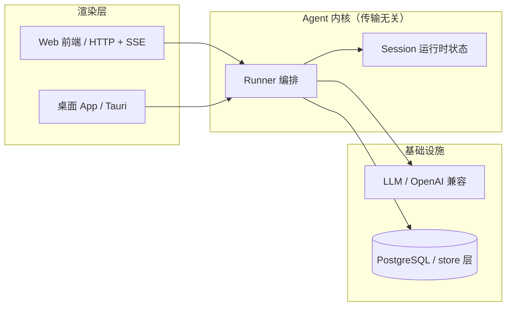

# Converge

轻量级桌面任务 Agent：能听懂自然语言指令的助手，自主规划步骤、操作文件、执行命令（带安全确认）、处理文档。基于 ReAct 循环（推理→行动→观察）与 Function Calling 实现，Web 端（HTTP + SSE）先行，后续扩展桌面端，三端共用同一套 agent 内核。

## 技术亮点

- **传输无关的 Runner 内核**：agent 内核只产出事件流（`chunk` / `done` / `error`，后续扩 `tool_call` / `confirm_request` / `ask_user`），不 print、不碰任何传输层。Web（HTTP + SSE）、桌面端都只是 renderer，同一套循环多端复用。
- **断点续跑模型**：确认 / 澄清不靠长连接挂起——断点落 `session.pending`，一段流结束，用户答复后新请求续跑（v2.x 落地）。
- **流式对话 + 多轮记忆**：OpenAI 兼容协议流式调 LLM，历史全量落 PostgreSQL，重启不丢、多进程共享。
- **中断一致性**：正常结束 / 报错 / 连接被掐断三条路径都保证"屏幕上看到的 = 库里存的"，半截回复照样落库。
- **多模型配置**：`models.yaml` 声明式配置（默认 + 可选列表，用户可自加），key 走 `.env`，漏配启动即报错。
- **数据存储**：PostgreSQL + SQLAlchemy ORM + Alembic 迁移管理表结构，docker compose 一键起库。

## 架构



## 快速开始

```bash
# 1. 安装依赖（需要 uv）
uv sync

# 2. 起数据库 + 建表
docker compose up -d
uv run alembic upgrade head

# 3. 配置模型：复制 .env / models.example.yaml 为 .env / config/models.yaml，填入真实 key
cp .env.example .env
cp config/models.example.yaml config/models.yaml

# 4. 启动服务
uv run uvicorn main:app --reload
# 健康检查：curl http://127.0.0.1:8000/api/health
```

## API

流式对话走 HTTP + SSE：`POST /api/chat` 返回 `text/event-stream`，首帧 `session`（带 session_id），之后 `chunk` 逐段推进，`done` 收尾。带上 `session_id` 即可续接多轮上下文。

```bash
# 首轮（服务端自动建会话）
curl -N -X POST http://127.0.0.1:8000/api/chat \
  -H 'Content-Type: application/json' \
  -d '{"content": "你好"}'

# 多轮（带首轮返回的 session_id）
curl -N -X POST http://127.0.0.1:8000/api/chat \
  -H 'Content-Type: application/json' \
  -d '{"content": "刚才我说了什么", "session_id": "xxx"}'
```

## 项目结构

```
.
├── api/              # 传输层：FastAPI 路由（HTTP + SSE），只做协议转换
├── agent/            # Agent 内核：runner（编排）、events（事件契约）、session（运行时状态）
├── config/           # 配置加载（pydantic-settings）+ models.yaml 多模型配置
├── llm/              # OpenAI 兼容流式客户端
├── store/            # 存储层：PostgreSQL + SQLAlchemy（db / model / session_store）
├── migrations/       # Alembic 迁移（表结构变更唯一入口）
├── main.py           # Web 入口
└── docs/plan.md      # 完整设计与路线图
```

## 路线图

| 版本 | 内容 |
|------|------|
| v1.1 | FastAPI + SSE 流式多轮对话 ✅ |
| v1.2 | 会话管理（列表 / 切换 / 历史拉取） |
| v2.x | ReAct 循环 + 文件读写 + 命令执行（带确认）+ 澄清提问 |
| v3.x | 文档处理 + 前端 UI + 桌面应用（Tauri） |
| v4.x | RAG 检索 + 效果评估 + 长期记忆 |

详细设计见 [docs/plan.md](docs/plan.md)。

## License

[MIT](LICENSE)
